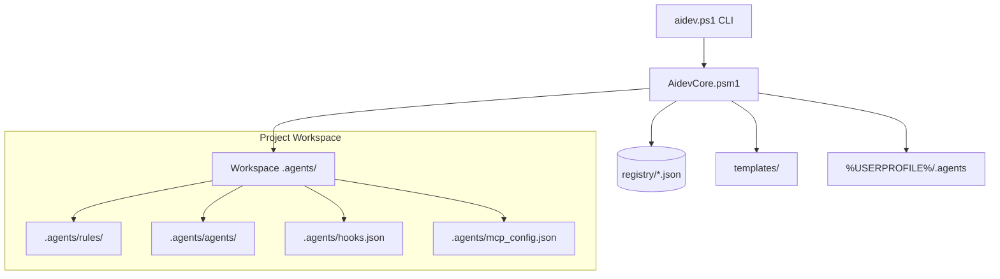

# AI-Dev-Machine Architecture v2 Overview

## System Purpose
O **AI-Dev-Machine** é um framework orquestrador e kit portátil para desenvolvimento assistido por IA no Windows. Ele padroniza, diagnostica e aplica governança contextual e determinística para Google Antigravity, OpenAI Codex, Claude Code e Gemini CLI.

## High-Level Topology

## Core Modules & Boundaries
- `core/AidevCore.psm1`: Motor PowerShell que implementa diagnósticos (`doctor`), auditoria (`audit`), inicialização (`init`), migração (`migrate`), resolução de perfis (`resolve`), limpeza (`clean`) e sincronização (`sync`).
- `registry/`: Fonte única da verdade em formato JSON contendo o catálogo de Skills, Agentes, MCPs, Plugins e Perfis.
- `templates/`: Modelos declarativos para criação e migração de projetos v2.
- `tests/`: Suíte de testes automatizados com cobertura de idempotência, migração, rollback com failure injection e segurança.
