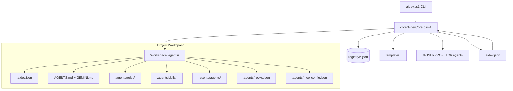

# AI-Dev-Machine Architecture v2.1 Overview

## System Purpose
O **AI-Dev-Machine v2.1** é um framework capability-driven e kit portátil para governança de desenvolvimento de software assistido por IA no Windows. Ele padroniza, diagnostica e materializa governança contextual determinística para Google Antigravity, OpenAI Codex, Claude Code e Gemini CLI.

## High-Level Topology

## Core Modules & Boundaries
- `core/AidevCore.psm1`: Motor PowerShell que implementa diagnóstico (`doctor`), detecção estrutural de stack (`detect`), manipulação de manifesto (`manifest`), resolução de grafo de capacidades (`resolve`), inicialização (`init`), migração segura com backup e rollback (`migrate`), materialização (`apply`), auditoria de 3 vias (`audit`), limpeza (`clean`) e sincronização da biblioteca global (`sync`).
- `registry/`: Fonte única da verdade em formato JSON contendo o catálogo de Capabilities (`capabilities.json`), Skills (`skills.json`), Agentes (`agents.json`), MCPs (`mcps.json`), Plugins (`plugins.json`) e Perfis como presets (`profiles.json`).
- `schemas/`: Schema JSON Draft-07 formal (`aidev-manifest.schema.json`) para validação rigorosa do manifesto declarativo `.aidev.json`.
- `templates/`: Modelos declarativos para constituição, bridges, regras gerenciadas e subagentes cognitivos.
- `docs/`: Documentação técnica, decisões de arquitetura (ADRs), runbooks e manual prático para primeiros prompts (`PRIMEIRO-PROMPT.md`).
- `tests/`: Suíte de testes automatizados com cobertura completa de resolução de capacidades, validação de manifesto, detecção de stack, migração brownfield com caminhos com espaços, rollback com injeção de falhas e extensibilidade sem alterações no core.
