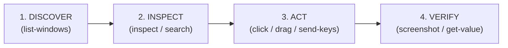

# Microsoft WinApp CLI (`winapp ui`) — Guia de Automação e QA Físico de Aplicações Windows

A skill **`winapp`** define os procedimentos operacionais, runbooks e comandos para automação e testes ponta a ponta (QA Físico) de aplicações desktop no Windows utilizando a ferramenta oficial da Microsoft: o **Microsoft Windows App Development CLI (`winapp`)**, especificamente através do subsistema **`winapp ui`**.

---

## 1. Quando Ativar esta Skill (Triggers)

Ative esta skill sempre que a tarefa envolver:
- **QA Físico / Testes de UI no Windows**: Testar o Controller ou qualquer aplicativo executando localmente no PC A ou em ambiente de testes.
- **Inspeção de Elementos UI**: Descobrir slugs semânticos, `AutomationId`, nomes de botões, inputs, abas, listas e coordenadas de tela.
- **Captura Visual e Evidências**: Tirar screenshots (`winapp ui screenshot`) ou gravar vídeos (`winapp ui record`) de janelas ou controles específicos.
- **Interação de Mouse e Gestos**: Clicar em botões (`click`), clique duplo, clique com botão direito, arrastar (`drag`) de um controle/coordenada para outro, e hover.
- **Entrada de Teclado e Atalhos**: Enviar sequências de teclas, atalhos (`Ctrl+C`, `Enter`, `Tab`) ou digitar texto (`send-keys`), escolhendo o transporte adequado (`post-message` ou `send-input`).
- **Preenchimento e Ajuste de Valores**: Definir valores diretamente em controles via UIA (`set-value`) ou consultar o estado atual (`get-value`, `get-property`).
- **Sincronização**: Aguardar elementos aparecerem, desaparecerem ou mudarem de estado (`wait-for`).

---

## 2. Instalação e Disponibilidade

O `winapp` é o CLI oficial da Microsoft para desenvolvimento e automação de apps Windows:
- **Package ID no winget**: `Microsoft.winappcli`
- **Comando de instalação**:
  ```powershell
  winget install Microsoft.winappcli --source winget
  ```
- **Verificação de versão**:
  ```powershell
  winapp --version
  ```

---

## 3. Fluxo Fundamental de Execução: DISCOVER ➔ INSPECT ➔ ACT ➔ VERIFY

Para garantir determinismo e evitar cliques em elementos inexistentes ou em coordenadas erradas, siga sempre o ciclo de 4 etapas:



### Etapa 1: Descobrir Janelas Ativas (DISCOVER)
Identifique a janela do processo alvo ou seu HWND:
```powershell
winapp ui list-windows -a "Controller" --json
```

### Etapa 2: Inspecionar a Árvore de UI (INSPECT)
Inspecione apenas os elementos interativos para identificar os **slugs semânticos** (ex.: `btn-connect-a1b2`, `txt-ip-3f4a`):
```powershell
# Inspecionar elementos interativos do aplicativo alvo
winapp ui inspect -a "Controller" -i --json

# Buscar um elemento específico por texto ou AutomationId
winapp ui search "Connect" -a "Controller"
```

### Etapa 3: Executar a Interação (ACT)
Use o slug obtido na etapa anterior ou coordenadas `x,y`:
```powershell
# Clicar em um botão pelo slug
winapp ui click btn-connect-a1b2 -a "Controller"

# Focar e digitar texto (para WinUI/WPF, use --via send-input)
winapp ui send-keys "192.168.1.100" -a "Controller" --target txt-ip-3f4a --via send-input

# Arrastar elemento ou mover slider (drag-and-drop)
winapp ui drag btn-thumb-1234 btn-track-end-5678 -a "Controller" --dwell-ms 100
```

### Etapa 4: Validação com Evidência Visual (VERIFY)
Capture screenshot para comprovar o resultado da ação (Iron Law):
```powershell
winapp ui screenshot -a "Controller" -o "evidence-step1.png" --json
```

---

## 4. Catálogo Detalhado de Comandos `winapp ui`

### A. Inspeção e Diagnóstico
| Comando | Descrição | Exemplo de Uso |
|---|---|---|
| `list-windows` | Lista janelas visíveis com HWND, título, PID e tamanho. | `winapp ui list-windows -a "Controller"` |
| `inspect` | Árvore UIA com slugs semânticos, tipos e dimensões. | `winapp ui inspect -a "App" -i -d 6` |
| `search` | Localiza elementos pelo nome ou texto. | `winapp ui search "Salvar" -a "App"` |
| `get-property` | Lê propriedades UIA detalhadas de um elemento. | `winapp ui get-property btn-ok-1234 -a "App"` |
| `get-value` | Lê o valor textual atual (TextPattern, ValuePattern). | `winapp ui get-value txt-status-5678 -a "App"` |
| `get-focused` | Informa qual elemento está com foco de teclado. | `winapp ui get-focused -a "App"` |

### B. Ações de Mouse e Entrada Física
| Comando | Descrição | Exemplo de Uso |
|---|---|---|
| `click` | Clica em um elemento via simulação de mouse. Suporta `--double` e `--right`. | `winapp ui click btn-refresh-a1b2 -a "App"` |
| `invoke` | Dispara o padrão UIA nativo (`InvokePattern`, `TogglePattern`). | `winapp ui invoke chk-enable-1234 -a "App"` |
| `drag` | Pressiona, arrasta e solta entre 2 slugs ou coordenadas `x,y`. | `winapp ui drag 150,200 450,200 -a "App" --hold-ms 50` |
| `hover` | Move o cursor para o centro do elemento e aguarda hover. | `winapp ui hover btn-info-a1b2 -a "App"` |
| `scroll` | Rola container com ScrollPattern ou roda do mouse (`--wheel`). | `winapp ui scroll list-items-1234 --direction down` |

### C. Teclado e Entrada de Dados
| Comando | Descrição | Exemplo de Uso |
|---|---|---|
| `send-keys` | Envia texto, teclas nomeadas (`enter`, `tab`, `down`) e combos (`ctrl+s`). | `winapp ui send-keys "ctrl+s" -a "App" --via send-input` |
| `set-value` | Altera valor programaticamente sem necessidade de foco. | `winapp ui set-value txt-name-1234 "Novo Valor" -a "App"` |
| `focus` | Atribui foco de teclado a um elemento específico. | `winapp ui focus txt-search-1234 -a "App"` |

### D. Evidências e Sincronização
| Comando | Descrição | Exemplo de Uso |
|---|---|---|
| `screenshot` | Captura janela ou elemento para PNG. Suporta `--capture-screen`. | `winapp ui screenshot -a "App" -o "tela.png"` |
| `record` | Grava vídeo H.264 MP4 da janela ou tela por N segundos. | `winapp ui record -a "App" --duration-sec 5 -o "fluxo.mp4"` |
| `wait-for` | Aguarda elemento aparecer, sumir ou atingir valor. | `winapp ui wait-for btn-ready-1234 -a "App" --timeout-ms 5000` |

---

## 5. Cuidados Essenciais: XAML / WinUI 3 vs Win32 Clássico

1. **Transporte de Teclado (`--via`)**:
   - Para apps **WinUI 3 / UWP / WPF XAML**: os controles não têm HWND próprio. Use sempre `--via send-input` no `send-keys`.
   - Para apps **Win32 clássicos / WinForms**: o padrão `post-message` funciona bem e não requer que a janela esteja no topo.
2. **Ambiente Interativo**:
   - Ações de mouse simulado (`click`, `drag`) exigem que a janela esteja visível e o desktop desbloqueado. Se necessário, traga a janela para o primeiro plano antes da ação.
3. **Opção `--json`**:
   - Utilize sempre `--json` ao integrar comandos do `winapp ui` em scripts automatizados para processar respostas e slugs via PowerShell/`jq`.
