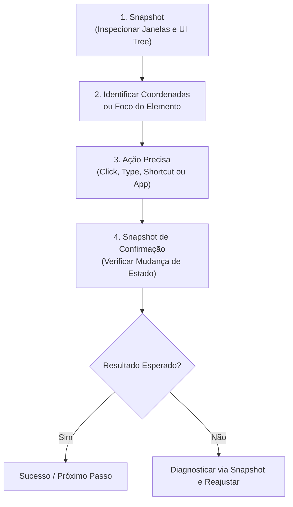

---
name: windows-mcp
description: >-
  Automação do desktop e sistema operacional Windows via MCP server windows-mcp.
  Use para interagir diretamente com aplicações nativas do Windows, inspecionar a interface gráfica (UI tree, vision, OCR),
  capturar telas, clicar, digitar, gerenciar janelas, processos, registro do Windows (Registry), área de transferência (Clipboard)
  e notificações do sistema.
---

# Windows MCP — Guia e Procedimentos de Automação do Desktop Windows

A skill **`windows-mcp`** fornece runbooks, padrões e procedimentos operacionais para controlar, inspecionar e automatizar o ambiente desktop e o sistema operacional Windows através das ferramentas do servidor MCP `windows-mcp`.

---

## 1. Quando Ativar esta Skill (Triggers)

Ative esta skill quando a tarefa envolver:
- **Automação Desktop / GUI**: Interagir com programas instalados no Windows (ex.: Notepad, Excel, navegadores, softwares de contabilidade, ERPs locais, ferramentas nativas).
- **Inspeção Visual e Elementos de Tela**: Tirar screenshots, inspecionar árvore de acessibilidade UI (UI Tree), localizar botões, caixas de texto e coordenadas de tela.
- **Entrada de Mouse e Teclado**: Clicar em botões específicos, arrastar elementos, rolar telas, preencher formulários desktop e disparar atalhos de teclado (`Win+R`, `Ctrl+S`, `Alt+Tab`).
- **Gerenciamento de Janelas e Apps**: Iniciar programas (`launch` ou caminho executável), alternar foco de janelas (`switch`), redimensionar (`resize`) e listar/matar processos (`Process`).
- **Sistema e Utilidades Windows**: Manipular chaves de registro (`Registry` no HKCU/HKLM), ler/escrever na área de transferência (`Clipboard`), enviar notificações nativas (`Notification`) e executar comandos PowerShell via MCP.

> 🛑 **Restrição de Ambiente**: Esta ferramenta é voltada exclusivamente para o ambiente Windows no Google Antigravity e Claude Code. Não deve ser acionada no OpenAI Codex.

---

## 2. Invocação de Ferramentas via MCP

Todas as ferramentas do `windows-mcp` são carregadas sob demanda (lazy-loaded). Para invocá-las, utilize a ferramenta `call_mcp_tool`:

```json
{
  "ServerName": "windows-mcp",
  "ToolName": "<NomeDaFerramenta>",
  "Arguments": { ... }
}
```

---

## 3. Catálogo Completo das Ferramentas do `windows-mcp`

### A. Observação e Inspeção da Interface (Look Before You Leap)

| Ferramenta | Finalidade | Argumentos Principais |
|---|---|---|
| **`Snapshot`** | **Ferramenta primária de observação**. Captura tela, idioma do sistema, janelas ativas e árvore completa de elementos UI clicáveis com coordenadas. | `use_vision`: boolean (default `false`)<br>`use_annotation`: boolean (default `true`, desenha caixas delimitadoras nos elementos)<br>`use_ui_tree`: boolean (default `true`)<br>`use_dom`: boolean (default `false`, para páginas web)<br>`display`: array (ex.: `[0]`) |
| **`Screenshot`** | Captura rápida de imagem bruta da tela sem extração da árvore de UI. | `display`: array (`[0]`), `output_path`: string opcional |
| **`Scrape`** | Extrai o conteúdo textual de uma janela ou região específica da tela. | `window_name`: string, `coords`: array opcional |
| **`DisplayInventory`** | Lista monitores conectados, resolução, taxa de escala (DPI) e monitor primário. | *(sem argumentos)* |

> ⚠️ **Regra Fundamental de Execução**:
> **NUNCA clique às cegas.** Sempre chame `Snapshot` antes de interagir com qualquer elemento visual para obter as coordenadas `[x, y]` reais e verificar se a janela desejada está no primeiro plano.

---

### B. Interação de Entrada (Mouse, Teclado & Formulários)

| Ferramenta | Finalidade | Argumentos Principais |
|---|---|---|
| **`Click`** | Realiza clique do mouse em coordenadas específicas ou em um elemento. | `loc`: `[x, y]`<br>`button`: `"left"` (default), `"right"`, `"middle"`<br>`clicks`: `1` (single) ou `2` (double click) |
| **`Move`** | Move o cursor do mouse para a coordenada `[x, y]`. | `loc`: `[x, y]` |
| **`Scroll`** | Rola o conteúdo vertical ou horizontalmente. | `amount`: inteiro (positivo para cima, negativo para baixo)<br>`loc`: `[x, y]` opcional |
| **`Type`** | Digita texto no campo atualmente focado. | `text`: string a digitar<br>`clear_before_type`: boolean<br>`press_enter`: boolean |
| **`Shortcut`** | Pressiona combinações de teclas do sistema. | `keys`: array de strings (ex.: `["win", "r"]`, `["ctrl", "c"]`, `["alt", "f4"]`) |
| **`MultiEdit`** | Preenche múltiplos campos de texto em formulários desktop em lote. | `edits`: array de objetos `[{ loc: [x, y], text: "..." }]` |
| **`MultiSelect`** | Seleciona múltiplos itens em caixas de listagem ou menus. | `selections`: array de coordenadas ou IDs |

---

### C. Gerenciamento de Aplicações e Janelas

| Ferramenta | Finalidade | Argumentos Principais |
|---|---|---|
| **`App`** | Gerencia ciclo de vida e foco de aplicações desktop. | `mode`: `"launch"` \| `"launch_executable"` \| `"switch"` \| `"resize"`<br>`name`: nome no menu Iniciar (para `launch`) ou título da janela (para `switch`/`resize`)<br>`executable`: caminho absoluto para `.exe`<br>`args`: argumentos de linha de comando<br>`window_loc`: `[x, y]`<br>`window_size`: `[w, h]` |
| **`Process`** | Lista ou encerra processos em execução no Windows. | `mode`: `"list"` ou `"kill"`<br>`name`: nome da imagem (ex.: `notepad.exe`)<br>`pid`: ID do processo (para `kill`) |
| **`Wait`** | Aguarda um tempo determinado em segundos. | `seconds`: número de segundos |
| **`WaitFor`** | Aguarda até que uma condição (como janela aberta ou elemento visível) seja satisfeita. | `target`: nome da janela ou elemento<br>`timeout`: tempo máximo em segundos |

---

### D. Utilidades do Sistema Operacional Windows

| Ferramenta | Finalidade | Argumentos Principais |
|---|---|---|
| **`PowerShell`** | Executa comandos nativos do PowerShell através do MCP. | `command`: comando ou scriptlet<br>`timeout`: timeout em segundos (default 30) |
| **`FileSystem`** | Operações de arquivo via MCP (leitura, escrita, listagem, criação de diretório). | `mode`: `"read"`, `"write"`, `"list"`, `"delete"`, `"mkdir"`, `"info"`<br>`path`: caminho do arquivo |
| **`Clipboard`** | Lê ou altera a área de transferência do Windows. | `mode`: `"get"` (lê) ou `"set"` (escreve)<br>`text`: texto a copiar (quando `mode="set"`) |
| **`Notification`** | Dispara notificação nativa do Windows (Toast Notification). | `title`: título do aviso<br>`message`: corpo da notificação |
| **`Registry`** | Lê, cria, modifica ou remove chaves e valores no Registro do Windows. | `mode`: `"get"`, `"set"`, `"delete"`, `"list"`<br>`path`: ex.: `"HKCU:\Software\MeuApp"`<br>`name`: nome da entrada<br>`type`: `"String"`, `"DWord"`, etc.<br>`value`: valor a gravar |

---

## 4. Fluxo Operacional Canônico: O Ciclo OBSERVE-ACT-VERIFY

Toda automação desktop deve seguir este ciclo estrito de 4 etapas:



### Exemplo Prático 1: Abrir Bloco de Notas, Digitar Texto e Salvar

1. **Abrir a Aplicação**:
   ```json
   call_mcp_tool("windows-mcp", "App", { "mode": "launch", "name": "Notepad" })
   ```
2. **Aguardar e Inspecionar a Tela**:
   ```json
   call_mcp_tool("windows-mcp", "WaitFor", { "target": "Bloco de Notas", "timeout": 5 })
   call_mcp_tool("windows-mcp", "Snapshot", { "use_ui_tree": true, "use_annotation": false })
   ```
3. **Focar e Digitar Texto**:
   ```json
   call_mcp_tool("windows-mcp", "Type", { "text": "Relatório gerado automaticamente.", "press_enter": true })
   ```
4. **Acionar Salvar com Atalho de Teclado**:
   ```json
   call_mcp_tool("windows-mcp", "Shortcut", { "keys": ["ctrl", "s"] })
   ```

### Exemplo Prático 2: Consultar e Gravar Registro do Windows

1. **Ler uma chave de configuração**:
   ```json
   call_mcp_tool("windows-mcp", "Registry", {
     "mode": "get",
     "path": "HKCU:\\Software\\Microsoft\\Windows\\CurrentVersion\\Explorer",
     "name": "ShellState"
   })
   ```
2. **Listar entradas de um software**:
   ```json
   call_mcp_tool("windows-mcp", "Registry", {
     "mode": "list",
     "path": "HKCU:\\Software\\CustomApp"
   })
   ```

---

## 5. Diretrizes de Segurança e Boas Práticas

1. **Proteção do Sistema**:
   - **NUNCA** finalize processos críticos do Windows (`csrss.exe`, `lsass.exe`, `explorer.exe`, `svchost.exe`, `services.exe`) via `Process kill`.
   - Modificações em `HKLM` (HKEY_LOCAL_MACHINE) afetam todo o sistema e requerem validação e cautela redobrada. Prefira chaves de usuário em `HKCU` quando possível.
2. **Resiliência a Timing (Latência de Interface)**:
   - Softwares desktop têm tempos de resposta diferentes. Sempre use `WaitFor` ou `Wait` breve (ex.: 0.5s a 1s) após abrir diálogos modais pesados antes de disparar cliques imediatos.
3. **Higiene de Clipboard**:
   - Ao ler ou gravar senhas e credenciais confidenciais na área de transferência, limpe o clipboard imediatamente após a operação (`mode: "set"`, `text: ""`).
