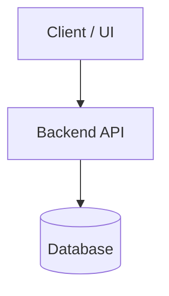

# Architecture Overview

## System Purpose
[Brief summary of the application, problem solved, and target users]

## High-Level Topology

## Core Modules & Boundaries
- `module-a`: [Description and responsibilities]
- `module-b`: [Description and responsibilities]
